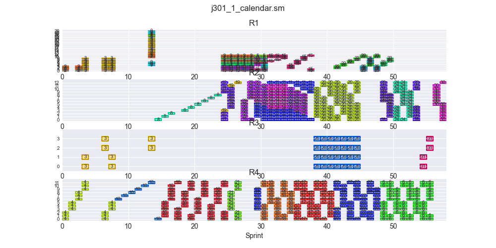
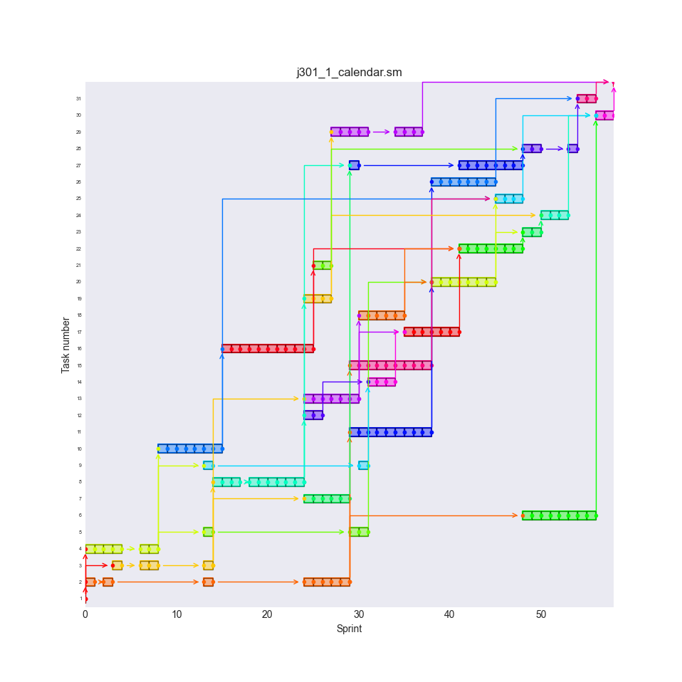
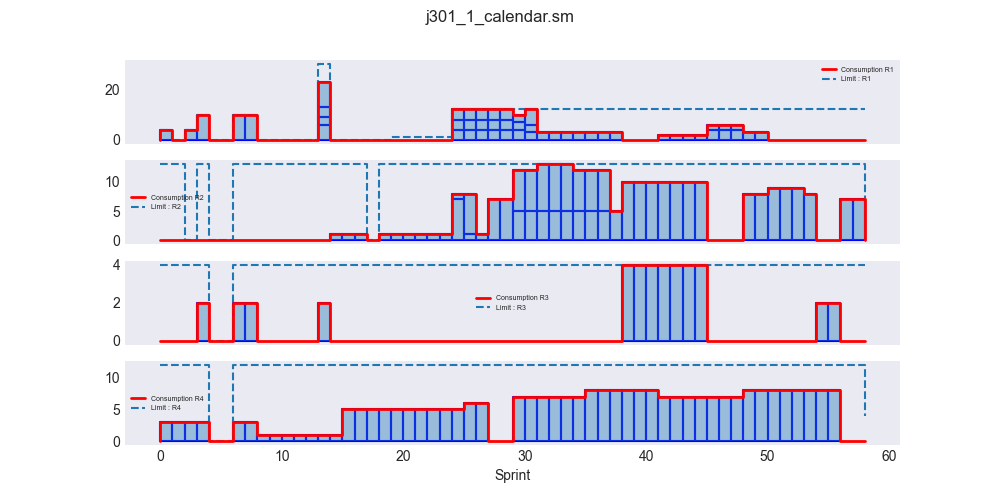

# Industrial Operations Research & RCPSP: Agile DevOps Scheduling

<div align="center">

[](https://python.org/)
[](https://www.om-db.wi.tum.de/psplib/)
[](https://github.com/airbus/discrete-optimization)
[](https://github.com/lgcorzo)
[](LICENSE)

### **Mathematical Modeling & Heuristic Optimization for Resource-Constrained Agile Backlogs**
*Developed by Dr. Luis Galo Corzo · Presented at Datatón BAIC (Basque Artificial Intelligence Center)*

</div>

---

## 🔬 Executive Overview

In enterprise software engineering and industrial product development, engineering leaders face a critical divergence between **Agile execution** (Epics, Features, User Stories, and Sprint backlogs in Azure DevOps or Jira) and **strategic capacity governance** (Gantt-style makespan projections, renewable resource allocation, and hard precedence deadlines).

This repository formulates the **Agile Backlog Scheduling Problem** as a formal **Resource-Constrained Project Scheduling Problem (RCPSP)**. By converting hierarchical agile work items and precedence dependencies into standard **PSPLIB** problem representations, it applies metaheuristic solvers and constraint programming to automatically generate optimal, conflict-free project schedules that minimize total project makespan under finite developer and compute resource capacities.

---

## 🏛️ System Architecture & Optimization Pipeline

```
┌───────────────────────────────────────────────────────────────────────────────────────────┐
│                                   OPTIMIZATION PIPELINE                                   │
└─────────────────────────────────────────────┬─────────────────────────────────────────────┘
                                              │
 1. BACKLOG INGESTION                         ▼
 ┌─────────────────────────────────────────────────────────────────────────────────────────┐
 │ Azure DevOps / Jira Backlog Hierarchy:                                                   │
 │ Epics ──► Features ──► User Stories ──► Tasks (Precedence Graph G = (V, E))              │
 └────────────────────────────────────────────┬────────────────────────────────────────────┘
                                              │
 2. FORMAL FORMULATION                        ▼
 ┌─────────────────────────────────────────────────────────────────────────────────────────┐
 │ Agile to PSPLIB Converter (`parser_calendar.py`, `rcpsp_calendar.py`):                  │
 │ • Task durations: Story point estimation & activity hours                                │
 │ • Renewable resources: Developer roles, capacity hours renewed per Sprint period        │
 │ • Precedence constraints: Finish-to-Start DAG relations                                  │
 └────────────────────────────────────────────┬────────────────────────────────────────────┘
                                              │
 3. SOLVER EXECUTION                          ▼
 ┌─────────────────────────────────────────────────────────────────────────────────────────┐
 │ Heuristic & Constraint Solvers (`discrete-optimization`, `scikit-decide`):               │
 │ • Genetic Algorithm (GA) Schedule Generation Schemes (SGS)                               │
 │ • Constraint Programming (CP-SAT) & Large Neighborhood Search (LNS)                       │
 └────────────────────────────────────────────┬────────────────────────────────────────────┘
                                              │
 4. VERIFIED DELIVERY                         ▼
 ┌─────────────────────────────────────────────────────────────────────────────────────────┐
 │ Output Artifacts:                                                                       │
 │ • Conflict-free makespan schedule (`solution.csv`)                                       │
 │ • Resource consumption Gantt charts (`gantt_horas_consumidas.png`)                       │
 └─────────────────────────────────────────────────────────────────────────────────────────┘
```

---

## 📐 Mathematical Formulation (RCPSP)

The project scheduling problem is formally specified as:

### 1. Variables & Sets
- $\mathcal{V} = \{0, 1, \dots, n, n+1\}$: Set of activities, where $0$ and $n+1$ are dummy source and sink nodes.
- $\mathcal{R}$: Set of renewable resource types (e.g., Senior Engineers, Frontend Developers, QA Specialists).
- $R_k$: Total capacity limit of renewable resource $k \in \mathcal{R}$ in each sprint interval.
- $p_j$: Non-preemptive processing duration of activity $j \in \mathcal{V}$.
- $r_{j, k}$: Demand of activity $j$ for resource $k \in \mathcal{R}$.
- $\mathcal{E} \subset \mathcal{V} 	imes \mathcal{V}$: Precedence relations graph where $(i, j) \in \mathcal{E}$ indicates that task $i$ must complete before task $j$ can start.

### 2. Objective: Minimize Makespan
$$\min S_{n+1}$$
where $S_j$ represents the start time of activity $j$.

### 3. Constraints
1. **Precedence Feasibility:**
   $$S_j - S_i \ge p_i \quad orall (i, j) \in \mathcal{E}$$

2. **Renewable Resource Availability:**
   $$\sum_{j \in \mathcal{A}(t)} r_{j, k} \le R_k \quad orall k \in \mathcal{R}, \, orall t \ge 0$$
   where $\mathcal{A}(t) = \{j \in \mathcal{V} \mid S_j \le t < S_j + p_j\}$ represents the set of active tasks executing at time $t$.

3. **Non-Negativity:**
   $$S_j \ge 0 \quad orall j \in \mathcal{V}$$

---

## 📊 Optimization Results & Visualizations

### 1. Resource Consumption Gantt Chart
Visualizing task scheduling across time horizons against sprint capacity ceilings:



### 2. Multi-Activity Schedule Alignment
Optimized Gantt sequencing minimizing makespan while respecting cross-team dependency links:



### 3. Capacity Consumption Profile
Comparison of estimated versus consumed hours per resource category across project sprints:



---

## 💻 Codebase Organization

```
├── Code/
│   ├── parser_calendar.py            # Calendar parsing and working-hour conversion
│   ├── rcpsp_calendar.py             # Calendar-aware RCPSP model definition
│   ├── rcpsp_calendar_utils.py       # Heuristics, precedence checks & schedule validators
│   ├── rcpsp_calendar_examples.py    # Example problem instances and benchmark harnesses
│   ├── rcpsp_datasets.py             # Dataset generators & PSPLIB converters
│   └── solution.csv                  # Verified schedule output matrix
├── Documentation/                    # Complete architectural dossier & figures
│   ├── README.md                     # Extended dataton documentation
│   ├── Media/                        # Agile diagram source assets
│   └── ...                           # Plots & Gantt visual artifacts
├── Notebooks/
│   └── RCPSPtutorials/               # Jupyter interactive tutorials & step-by-step solver walkthroughs
├── Tests/                            # Unit and integration tests for schedule feasibility
└── solution.csv                      # Baseline benchmark solution
```

---

## 🚀 Getting Started

### 1. Prerequisites & Environment Setup
Clone the repository and install dependencies using Python 3.10+:

```bash
git clone https://github.com/lgcorzo/devops_job_shop_scheduling.git
cd devops_job_shop_scheduling
pip install -r requirements.txt  # or install discrete-optimization & scikit-decide
```

### 2. Running an Example Scheduling Run
Execute the calendar-aware RCPSP solver:

```bash
python Code/rcpsp_calendar_examples.py
```

### 3. Inspecting the Solution
The solver outputs the optimal start and finish times for every user story and task to `solution.csv`:

```bash
head -n 10 solution.csv
```

---

## 📚 References & Standards

1. **PSPLIB Library:** Kolisch, R., & Sprecher, A. (1997). *PSPLIB - A library of project scheduling problems*. European Journal of Operational Research, 96(1), 205-216.
2. **Airbus Discrete Optimization:** [discrete-optimization repository](https://github.com/airbus/discrete-optimization) — State-of-the-art metaheuristics and CP-SAT solvers.
3. **Scikit-Decide:** [scikit-decide framework](https://github.com/airbus/scikit-decide) — AI framework for Reinforcement Learning, Planning, and Scheduling.
4. **Basque Artificial Intelligence Center (BAIC):** Developed and presented as part of Datatón BAIC exploring AI for industrial project governance.

---

<div align="center">

Maintained by [Dr. Luis Galo Corzo](https://github.com/lgcorzo) • [Portfolio Website](https://lgcorzo.github.io/)

</div>
